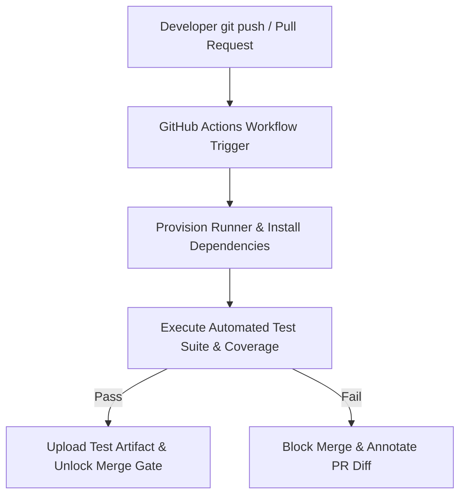

# Test with Actions

> **Author & Architect:** [Robina Mirbahar](https://github.com/RobinaMirbahar) (Google Developer Expert in Cloud & AI)  
> **Focus:** Production GitHub Actions CI/CD Pipelines for Automated Unit Testing, Coverage Reports & Pull Request Gatekeeping

---

## 🎯 Why I Built Automated CI/CD Testing Workflows with GitHub Actions (Engineering Purpose & Real-World Value)

### 1. ✅ Enforcing Zero-Regression Pull Request Gates
I configured this repository to demonstrate how automated GitHub Actions workflows run unit tests and coverage checks on every push and pull request before code can merge.

### 2. 📦 Matrix Testing & Artifact Upload
Shows how to structure `.github/workflows/` YAML pipelines that capture test reports and surface failures directly in PR status checks.

### 3. 🚀 Reproducible DevSecOps Foundation
Serves as a clean CI testing template for my cloud and AI engineering repositories.

---

## 🏗️ System Architecture

---

Hey RobinaMirbahar!

Mona here. I'm done preparing your exercise. Hope you enjoy! 💚

Remember, it's self-paced so feel free to take a break! ☕️

---

&copy; 2025 GitHub &bull; [Code of Conduct](https://www.contributor-covenant.org/version/2/1/code_of_conduct/code_of_conduct.md) &bull; [MIT License](https://gh.io/mit)

---

### 🚀 Featured Google Cloud & Agentic AI Portfolio by Robina Mirbahar

| Repository | Architecture & Focus | Live Status |
| :--- | :--- | :--- |
| **[gemma4-multilora-adk-eval](https://github.com/RobinaMirbahar/gemma4-multilora-adk-eval)** | Dynamic Multi-LoRA Hot-Swapping & CI/CD Agent Evaluation (`adk eval`) on Cloud Run GPUs with Gemma 4 & vLLM |   |
| **[slothsre-napops](https://github.com/RobinaMirbahar/slothsre-napops)** | SlothSRE ("NapOps") — Overnight Gemma 4 & Google ADK Incident Digest Agent with OpenTelemetry & Sentry AI Monitoring |   |
| **[streamforge-event-adk](https://github.com/RobinaMirbahar/streamforge-event-adk)** | Real-Time Event-Driven Multi-Agent Pipelines on Google Cloud with ADK (`ParallelAgent` & `LoopAgent`), Eventarc & Pub/Sub |   |
| **[a2a-mcp-mesh-cloudrun](https://github.com/RobinaMirbahar/a2a-mcp-mesh-cloudrun)** | Agent-to-Agent (A2A) & Multi-MCP Mesh on Cloud Run with Gemma 4, Google ADK, Spanner Graph & AlloyDB |   |
| **[cloudguard-gemma-agent](https://github.com/RobinaMirbahar/cloudguard-gemma-agent)** | 6-Part Production Gemma Enterprise Agent Series (ADK, Cloud Run L4 GPU, Firestore, Model Armor, Vertex AI QLoRA) |   |
| **[Comic-Studio-Ai](https://github.com/RobinaMirbahar/Comic-Studio-Ai)** | Multi-Agent Comic Generator powered by Google Gemini API & FastAPI deployed on Google Cloud Run |   |
| **[vertex-ai-imagen3](https://github.com/RobinaMirbahar/vertex-ai-imagen3)** | Generate AI-powered product & editorial images using Google Vertex AI Imagen 3 in Google Colab |   |
| **[Python-Learning-Assistant](https://github.com/RobinaMirbahar/Python-Learning-Assistant)** | AI-powered Python tutor covering 50+ interactive exercises with real-time feedback built with Streamlit + Gemini API |   |
| **[cozy-ai-agent-cafe-game](https://github.com/RobinaMirbahar/cozy-ai-agent-cafe-game)** | Prompt Paws: 60 FPS Cozy AI Agent Bakery Simulation Game teaching RAG, Guardrails, Context Caching & Multi-Agent Loops |   |

  

<!-- AUTHOR_SIGNATURE_START -->
---

## 👩‍💻 About the Author

**Robina Mirbahar — Google Cloud & AI Architect**  
*Google Developer Expert (GDE) in Cloud & AI • Published Author • Multi-Agent Systems & Serverless GPU Builder*

<!-- AUTHOR_SIGNATURE_END -->
