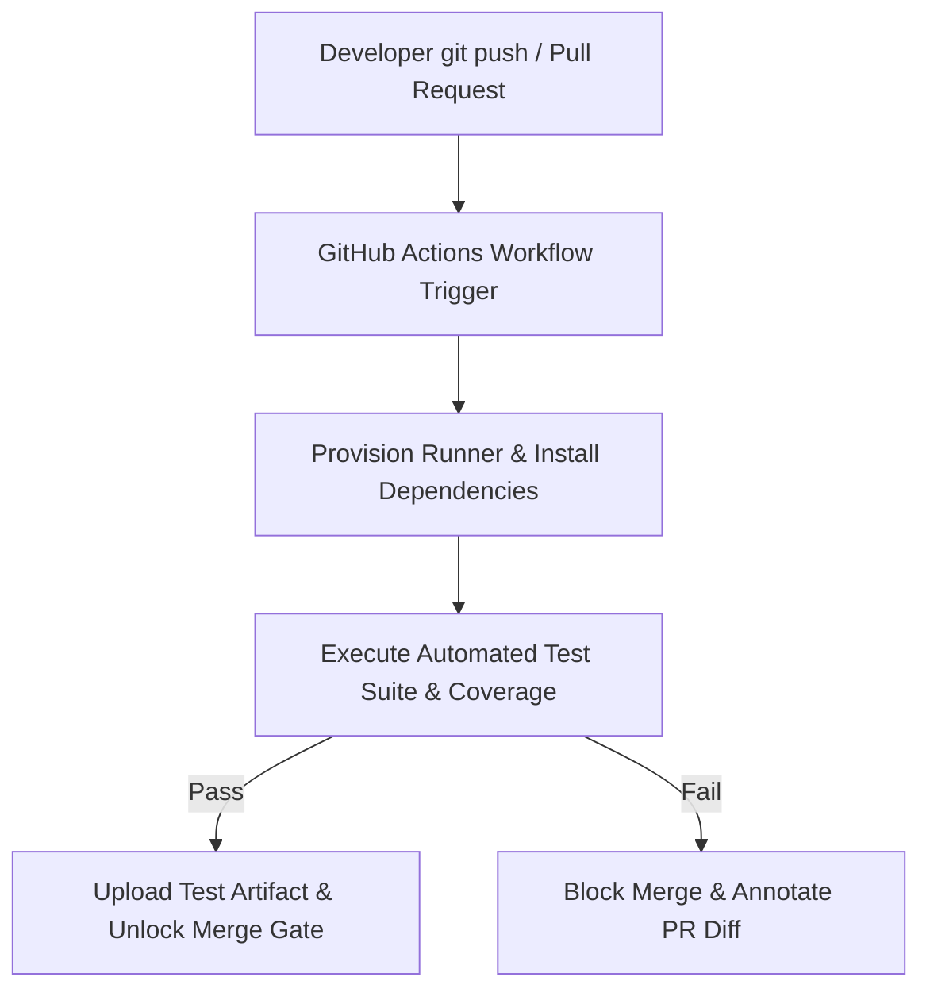

# Test with Actions

> **Author & Architect:** [Robina Mirbahar](https://github.com/RobinaMirbahar) ([Google Developer Expert in Cloud & AI](https://developers.google.com/profile/u/106918534005910641104?utm_campaign=deveco_gdemembers&utm_source=deveco) · Google Cloud Champion Innovator · Co-Author of [*AI Engineering*](https://www.amazon.com/dp/B0GWCZWCF4))  
> **Focus:** Production GitHub Actions CI/CD Pipelines for Automated Unit Testing, Coverage Reports & Pull Request Gatekeeping

---

## 🎯 Why I Built Automated CI/CD Testing Workflows with GitHub Actions (Engineering Purpose & Real-World Value)

### 1. ✅ Enforcing Zero-Regression Pull Request Gates
I configured this repository to demonstrate how automated GitHub Actions workflows run unit tests and coverage checks on every push and pull request before code can merge.

### 2. 📦 Matrix Testing & Artifact Upload
Shows how to structure `.github/workflows/` YAML pipelines that capture test reports and surface failures directly in PR status checks.

### 3. 🚀 Reproducible DevSecOps Foundation
Serves as a clean CI testing template for my cloud and AI engineering repositories.

---

## 🏗️ System Architecture

---

Hey RobinaMirbahar!

Mona here. I'm done preparing your exercise. Hope you enjoy! 💚

Remember, it's self-paced so feel free to take a break! ☕️

---

&copy; 2025 GitHub &bull; [Code of Conduct](https://www.contributor-covenant.org/version/2/1/code_of_conduct/code_of_conduct.md) &bull; [MIT License](https://gh.io/mit)
---

### Official Google Developer Resources
- [Google for Developers](https://developers.google.com/?utm_campaign=deveco_gdemembers&utm_source=deveco)
- [Google Cloud AI Documentation](https://cloud.google.com/ai?utm_campaign=deveco_gdemembers&utm_source=deveco)
